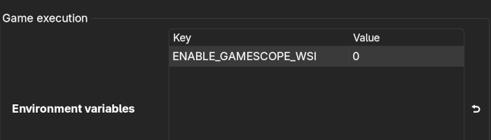

<h1>SP Football Life 2027</h1>
<h3>Steam Deck / Linux Installer</h3>

> [!Important]
> 31/10/2026: This script is based on the working SP Football Life 2026 script and has not yet been tested against the final FL27 1.00 release. You need Lutris 0.5.20 or newer. If you hit problems, please [open an issue](https://github.com/eskay993/gamefiles/issues/new?assignees=&labels=&projects=&template=issue.md&title=) with the full Lutris log.

- [Install Guide](#install-guide)
- [Useful info](#useful-info)
  - [How to install updates](#how-to-install-updates)
  - [How to backup / restore your game saves](#how-to-backup--restore-your-game-saves)
  - [How to run `Settings` or `Switcher` tool](#how-to-run-settings-or-switcher-tool)
  - [How to add SPFL to Steam Library / Game Mode](#how-to-add-spfl-to-steam-library--game-mode)
  - [How to clear your Lutris cache](#how-to-clear-your-lutris-cache)
- [Troubleshooting](#troubleshooting)
  - [I'm getting errors during the install... help!](#im-getting-errors-during-the-install-help)
  - [Black screen with audio on Steam Deck](#black-screen-with-audio-on-steam-deck)
  - [My controller is not being detected](#my-controller-is-not-being-detected)
  - [The gameplay is flickering or missing texture during a match](#the-gameplay-is-flickering-or-missing-texture-during-a-match)
  - [I'm still seeing black borders even with the aspect ratio patch](#im-still-seeing-black-borders-even-with-the-aspect-ratio-patch)
- [Credits](#credits)
- [Additional Resources](#additional-resources)

## Intro

Lutris script to install SP Football Life 2027 by [SmokePatch](https://www.pessmokepatch.com/). You can read about the game on their website, as well as download the game installer, updates and mods.

To get the game, go to [SP Football Life 2027](https://www.pessmokepatch.com/2026/10/spfl27.html) and open the [download links page](https://www.pessmokepatch.com/p/fl27-links.html). Download all parts (`SPFL27.part01.rar` to `SPFL27.part08.rar`) plus the latest update, if there is one.

You need about 40 GB of free space for the install. On a 64 GB Steam Deck, use an SD card or external drive.

# Install Guide

This guide assumes you're installing on a Steam Deck. The steps are the same for a regular Linux desktop, with the possible exception of where to get Lutris, which may differ for your particular distro of choice.

1. Important: Make sure Lutris is installed and fully updated on your Steam Deck. You need at least version `0.5.20`. You can install it and update it from the `Discover` app. If you're not sure how to install it, then follow the first 1 min of [this guide](https://www.youtube.com/watch?v=537bpLvPu64). Ignore the rest of the video.

2. Follow steps 1 and 2 from [Tutorial - Install SP Football Life](https://www.pessmokepatch.com/2022/10/installation.html) to download and extract the game from the [SmokePatch](https://www.pessmokepatch.com/) website. Only do steps 1 and 2, then come back here after extracting the installer files. On Steam Deck you can extract the multi-part rar with `Ark` by right clicking `SPFL27.part01.rar` and choosing `Extract`. All parts must be in the same folder.

3. Download [sp-football-life-2027-win.zip](https://github.com/eskay993/gamefiles/raw/main/sp-football-life-2027/sp-football-life-2027-win.zip) from this repo and extract it.

4. Run Lutris and click the `+` sign to add a game.

5. Select `Install from local install script` and point to the extracted yaml script from step 3. Click `Install`.

6. On the next screen, choose where to install the game. On Steam Deck, Lutris by default will install the game to `/home/deck/Games/sp-football-life-2027`. Also tick `Create steam shortcut` so the game gets added to your Steam library. Click `Install`.

7. On the next screen, click `Browse` under `SPFL27_setup.exe` and select the `SPFL27_setup.exe` from the files you extracted in step 2. Click `Continue` and wait for the various files to download.

8. Click `Continue` to begin the install process. You may get a popup asking you to install mono. Just click cancel if you do.

9. After some requirements are installed, the SPFL setup window should appear. Just keep clicking `Next` and **leave everything as default, including the install folder**. The game should start installing. Click `Exit` when it's done.

10. Next, the `Switcher` app will open. Choose the settings you want and click `Apply` then `Close`. Have a look at the SPFL website or subreddit for more info on what these settings do.

11. Now click `Close` in Lutris and the game should now appear in your Lutris library.

12. Launch the game once from Lutris and choose `Display and Controller Settings` from the popup. Choose the following:
    - Select "`Full Screen`". If it's greyed out, select the highest resolution available in the dropdown and you should then be able to select Full Screen.

    - Choose "`Enable 2`" under V-Sync. Most people have better frame rate with this.

    - If you're using a PS controller AND you are planning to launch the game outside Steam, then make sure to click on the Controllers tab, select `DirectInput` then select your controller from the drop down menu. If you will be adding the game to Steam and launching it from there, then leave it on `XInput` since Steam by default converts any controller input to XInput.

13. If SmokePatch has released an update, install it now. Follow [How to install updates](#how-to-install-updates).

14. The final step! Please read the **important** notes below. And check [Troubleshooting](#troubleshooting) if you have any issues.

> [!IMPORTANT]
> On Steam Deck, when playing in Game Mode and adding the game through Lutris, you may encounter a black screen issue with audio. See [Black screen with audio on Steam Deck](#black-screen-with-audio-on-steam-deck)

> [!IMPORTANT]
> If game looks dark and you get flickering / missing textures during a match then Lutris probably did not download dxvk properly. Clear your Lutris cache following [these steps](#how-to-clear-your-lutris-cache) and try again.

> [!NOTE]
> FL27 ships with rendering set to Medium. You can change it in game under `Game Menu / Settings / System Settings / Video Settings`. Medium is a good starting point on Steam Deck.

### What the script does differently from FL26

Unlike FL26, the FL27 setup installs the game to `C:\Games\SP Football Life 2027` instead of `C:\Program Files (x86)`. On the Steam Deck that is `/home/deck/Games/sp-football-life-2027/drive_c/Games/SP Football Life 2027`. The FL27 launcher is `FL 2027 start.exe` and the switcher is `FL27 Switcher.exe`.

After the SPFL setup finishes, the script checks the game folder. If a future update installs to `Program Files (x86)` instead, the script links that folder to the expected location. If the launcher or switcher names change, it links the new names to the ones Lutris expects. It also points `FL_2027.bat` at the actual game exe. If no game folder is found, the install stops with an error. This usually means the install folder was changed in the SPFL setup.

# Useful info

## How to install updates

If you have already installed the game and want to install a future update, follow these steps:

On Steam Deck, follow the below steps in Desktop Mode.

1. Download and extract the latest update file from the [SP Football Life 2027](https://www.pessmokepatch.com/2026/10/spfl27.html) website. This can be found in the `Download Links` section.
2. Run Lutris and select `SP Football Life 2027` (single click just to highlight it)
3. Click the wine glass icon at the bottom and select `Run EXE inside Wine Prefix`
4. Browse to the extracted update exe downloaded in Step 1. Filename should be something like `SPFL27_XXX.exe`, where XXX is the version number.
5. Run through the installer clicking `Next` and leaving everything as default.
6. Done! You can confirm you have the latest version by launching the game and checking the bottom left corner on the main menu screen.

## How to backup / restore your game saves

> [!WARNING]
> Uninstalling the game from Lutris, or deleting the folder where the game is installed will also delete your save files. Make sure to backup the save folder before removing the game.

To make a backup of your save files, the folder is located in:

`<GAME_INSTALL_PATH>/drive_c/users/steamuser/Documents/KONAMI/`

For Steam Deck, if following the guide and installing to the default location then this will be:

`/home/deck/Games/sp-football-life-2027/drive_c/users/steamuser/Documents/KONAMI/`

The `users/deck` folder is only a link to `users/steamuser`, so back up the `steamuser` one.

To restore your save files after a fresh install, just copy the `KONAMI` folder to that location.

## How to run `Settings` or `Switcher` tool

The script comes with a menu that lets you choose to run Settings or Switcher right from Lutris.

In Desktop Mode, just launch the game in Lutris and select the option you want from the popup.

The Linux native Switcher and Settings tools made for FL26 are in the [sp-football-life-2026](../sp-football-life-2026) folder. They have not been updated for FL27 and may not work with it.

## How to add SPFL to Steam Library / Game Mode

This is required to do on Steam Deck to get the controller working. It's an optional step on Linux Desktops.

There are two methods to do this. Try the first, and if it doesn't work, try the second.

Method 1:

1. Exit Steam and open Lutris
2. Right click on the game and choose `Create steam shortcut`
3. The game should now be in your Steam library. Launch Steam to check.
4. On Steam Deck, launch into Game Mode and test the game to see if your controller is working.

In some instances, the above will not work (e.g. if you have multiple Steam accounts on your device). Try this method if you have issues:

Method 2:

1. In Lutris, right click on the game and choose `Create Desktop shortcut`. A shortcut to the game should now be on your desktop.
2. Open Steam, and in the bottom left corner click `Add a Game` and choose `Add a Non-Steam Game`
3. Click `Browse` and navigate to your desktop and choose the shortcut you created above. On Steam Deck, this will be at `/home/deck/Desktop`. If the shortcut is not appearing, choose `All Files` from the `Filter` menu at the bottom.
4. After selecting the shortcut, click `Add Selected Program` and you should be good to go.
5. On Steam Deck, launch into Game Mode and test the game to see if your controller is working.

## How to clear your Lutris cache

Sometimes Lutris doesn't download needed files correctly. If you have any random errors during install, or during launching of the game, then always try clearing Lutris cache first to see if it fixes things.

1. Close Lutris (important!)
2. Open `Dolphin` file browser and navigate to `~/.var/app/net.lutris.Lutris/cache/lutris`. Depending on how you installed Lutris, the cache folder may be here instead: `~/.cache/lutris`
3. Delete all the files in this folder (it's safe to do so)
4. Launch Lutris again and you should see it downloading stuff at the start
5. Try what you were doing again and see if it fixes the issue

# Troubleshooting

## I'm getting errors during the install... help!

First thing to try is [clear your Lutris cache](#how-to-clear-your-lutris-cache). Also make sure Lutris is fully updated using `Discover`. If you still have issues after this, then post an issue [here](https://github.com/eskay993/gamefiles/issues/new?assignees=&labels=&projects=&template=issue.md&title=) with the full error log (all the orange text in the Lutris window).

If the error says `Game folder not found`, re-run the install and keep the default install folder in the SPFL setup.

## Black screen with audio on Steam Deck

For some people, when launching the game in Game Mode you might get a black screen while still hearing the audio in the background. This is related to the flatpak version of gamescope installed alongside Lutris.

The yaml script already sets this, but if you still see it, try launching the game with `ENABLE_GAMESCOPE_WSI=0`. To do this:

- In Desktop Mode, right click the game in Lutris and choose `Configure` then `System Options`
- Scroll down to Environment Variables and click the `Add` button
- Under Key, put `ENABLE_GAMESCOPE_WSI`
- Under Value, put `0`

## My controller is not being detected

Please make sure you have the latest SmokePatch update installed before troubleshooting any controller issues. Follow [How to install updates](#how-to-install-updates).

- #### Not working in Desktop Mode:

It is recommended you play in Game Mode. To add the game to Game Mode, follow [these steps](#how-to-add-spfl-to-steam-library--game-mode). If you really want to play in Desktop mode, then hold down the `Start` button on the Steam Deck for a few seconds and it should switch the controller to Controller Mode. Hold `Start` again to switch back to Desktop Mode when you're done.

- #### Not working in Steam when using DirectInput / PlayStation Controller

Steam by default converts any controller input to XInput, so if you changed your controller setting to DirectInput in the Settings.exe app, then you need to disable Steam Input in Steam.

In Steam, right click on the game, go to `Properties`, `Controllers`, then choose `Disable Steam Input` from the drop down.

## The gameplay is flickering or missing texture during a match

If game looks dark and you get flickering / missing textures during a match then Lutris probably did not download dxvk properly. Clear your Lutris cache following [these steps](#how-to-clear-your-lutris-cache) and try again.

## I'm still seeing black borders even with the aspect ratio patch

The aspect ratio patch only works during matches. It does not work in menus. So you will see black bars in the menus, but the matches should be in full screen with no black bars.

# Credits

- SmokePatch for their awesome work on [SP Football Life](https://www.pessmokepatch.com/)

# Additional Resources

- [Tutorial - Download and extract SP Football Life](https://www.pessmokepatch.com/2022/10/installation.html)
- [How To Transfer Files From PC To Steam Deck](https://gamerant.com/how-transfer-files-pc-steam-deck/)
- [Lutris / Writing Installers](https://github.com/lutris/lutris/blob/master/docs/installers.rst)
- [/r/SPFootballLife](https://www.reddit.com/r/SPFootballLife/)
- [/r/SteamDeck](https://www.reddit.com/r/SteamDeck/)
